# Examples

The programs in [`examples/`](https://github.com/CTalkobt/M65Compiler/tree/main/examples),
each with what it shows and its screen 2.5 seconds after it starts (xemu-xmega65,
real speed). Build them all with `make -C examples` (or `make` in one example's
directory; most have `make run` to start xemu). The pictures are made by
[`examples/capture_screens.py`](https://github.com/CTalkobt/M65Compiler/blob/main/examples/capture_screens.py)
(run from the project root after building the examples).

The MEGA65's own boot screen and `READY.` prompt show in the pictures of the
programs that print text and return to BASIC.

## The examples disk

[Source](https://github.com/CTalkobt/M65Compiler/tree/main/examples/disk) —
`make -C examples/disk` builds every example and puts them on one D81 disk
image, `examples/disk/examples.d81`, with
[disk45](../bin/disk45.md): `create`, an `add` for each program (named as
in [`programs.txt`](https://github.com/CTalkobt/M65Compiler/blob/main/examples/disk/programs.txt)),
`validate` and `list`. The menu,
[`menu.bas`](https://github.com/CTalkobt/M65Compiler/blob/main/examples/disk/menu.bas),
is a BASIC 65 program written in [basic45](../bin/basic45.md)'s source form
(labels, no line numbers). It is saved as `AUTOBOOT.C65`, so a MEGA65 that
starts with the disk mounted runs it, and as `MENU`. It lists the examples on
pages of 13; space turns the page. A key loads and starts an example with `DLOAD`: inside a running program it loads the next one and runs
it, and every example is a BASIC `SYS` line at `$2001` followed by its code.
When an example ends, `RUN "MENU"` brings the menu back. `make -C examples/disk run`
starts xemu with the disk in drive 8; on a MEGA65, copy the D81 to the SD card
and mount it.

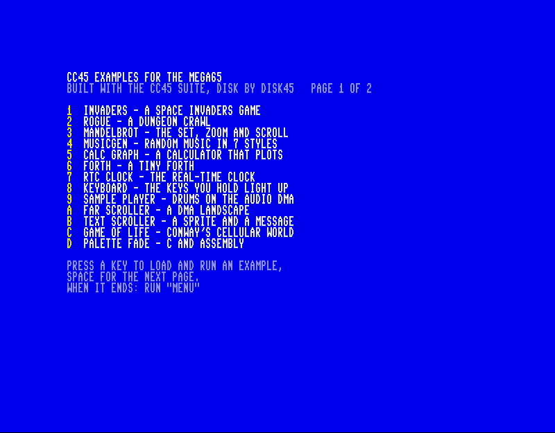

## Games and demos

### invaders

[Source](https://github.com/CTalkobt/M65Compiler/tree/main/examples/c/invaders) —
A Space Invaders game. The game objects are structs with single inheritance
and virtual `update()`/`draw()`, positions an operator-overloaded `Vec2`. The
character set is copied to bank 4 with `dma_copy_far` and redefined (aliens,
shields); the cannon and UFO are 16-colour VIC-IV sprites, their images in bank 4
too (16-bit sprite pointers); SID sound effects (through `<audio_sid.h>`)
and the marching beat. It starts on a title screen (shown): the name in block
letters in cycling colours, the score table typed out with the aliens marching
in place and the UFO sprite, the high score. After about 5 seconds without
input the computer plays (an attract mode) for about 20 seconds, then the title
comes back. FIRE or SPACE starts a game from either; Z/X, `,`/`.`, the cursor
keys or a joystick move; RUN/STOP quits.
The high score is kept on disk: `INVADERS.HI`, a sequential file on device 8
holding the score in decimal, read with `fopen`/`fread` at the start and
written with `fwrite` after a game that beat it (a missing file or a disk
error leaves it at 0; the attract mode's score does not count).

### mandelbrot

[Source](https://github.com/CTalkobt/M65Compiler/tree/main/examples/c/mandelbrot) —
A Mandelbrot set viewer: the VIC-IV's full-colour character mode as a
320x192 bitmap (a byte per pixel in bank 4), the iteration in 45GS02
assembly (the 32-bit Q register and the hardware multiplier, 4.28 fixed
point; points in the main cardioid and the period-2 bulb are recognised
without iterating), progressive rendering with border checks (an 8x8 cell
whose border is one colour is filled; otherwise its four 4x4 quadrants are
checked the same way; the picture is still filling in at 2.5 seconds),
palette cycling. Cursor keys or a joystick move,
Z/X zoom, `?` shows the keys.

### musicgen

[Source](https://github.com/CTalkobt/M65Compiler/tree/main/examples/c/musicgen) —
A random music generator in seven styles (pop, rock, blues, jazz,
classical, ambient, chiptune): Markov chord tables with fixed cadences, AABA
or 12-bar blues form, melodies built from a motif with chord tones on the
strong beats, voice-led chords, walking/boogie/Alberti bass and drums with
swing, played by 14 SID instruments on four SIDs (`<audio_sid.h>`: SIDs 1-2 mirrored to 3-4 for stereo). Keys 1-7 choose the style,
`+`/`-` the tempo, N a new song. `make check` composes songs of every style
and checks them against the chords and scales.

### calc_graph

[Source](https://github.com/CTalkobt/M65Compiler/tree/main/examples/c/calc_graph) —
A scientific calculator that plots. An expression (+ - * / ^, parentheses,
implicit multiplication like `2x` or `3sin(x)`, `x`, `pi`, `e`, `ans`, sin cos
tan atn sqrt log exp abs int) is compiled to bytecode by a shunting-yard
parser and run by an evaluator that dispatches with computed goto
(`goto *ops[*pc++]`), in cc45's ROM-backed floats; with `x` in it, it is
plotted (up to four curves) on a full-colour 320x128 graph. A raster
interrupt colours the graph area's border and background and counts frames:
an `__interrupt` handler behind a stub at the KERNAL's `$0314` vector, which
also handles interrupts that arrive while the float routines have the BASIC
ROM mapped over the program. Shows GCC extensions: computed goto, nested
functions, statement expressions with `typeof`, case ranges, designated
initializers, `?:`, `__attribute__`. The demo at the start computes two
values and plots three curves (shown); a marker runs along the newest one.
(xemu's exit screenshot is rendered without the CPU, so it shows no raster
split.)

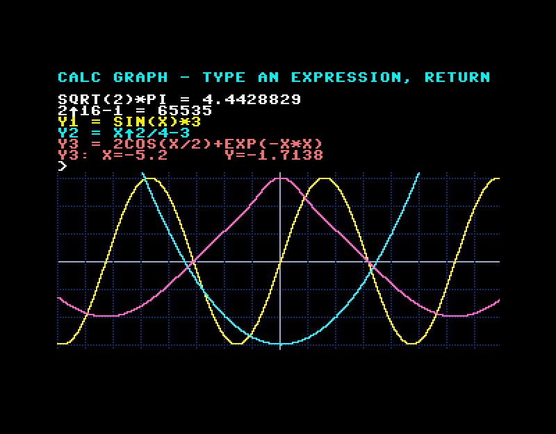

### rtc_clock

[Source](https://github.com/CTalkobt/M65Compiler/tree/main/examples/c/rtc_clock) —
The real-time clock in big digits (a 5x7 font drawn with reverse spaces),
the weekday and date, a bar of the seconds and a stopwatch counted in video
frames. The RTC's BCD registers at `$FFD7110`-`$FFD7116` lie outside the
16-bit address space, so a `dma_copy_far` copies them into a buffer each
frame. H switches 12/24 hours, S starts and stops the stopwatch, R resets
it, C changes the colours. `make check` reads the RTC twice, a second
apart, and checks the values.

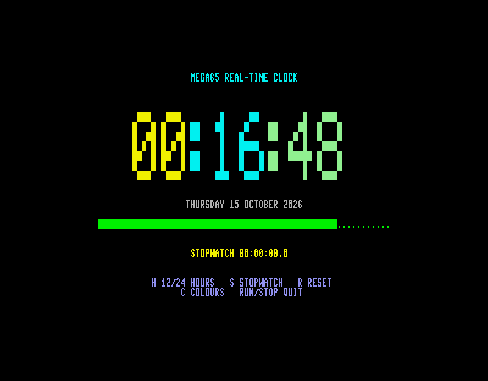

### sample_player

[Source](https://github.com/CTalkobt/M65Compiler/tree/main/examples/c/sample_player) —
A drum machine on the audio DMA (`<audio_digi.h>`). It needs no sample
files: at start it synthesizes a kick (a falling sine sweep), a snare (a
sine under noise), a hi-hat (high-passed noise) and a one-cycle sine tone
as 8-bit samples at 8 kHz, then plays them on the four audio DMA channels,
placed in the stereo field with `digi_set_volume`. The 16-step pattern
starts playing at once (SPACE stops and restarts it; four patterns, P); keys
1-3 trigger the drums, + and - set the
tempo, T loops the tone and Q/W change its pitch (the playback rate).
`make check` synthesizes the samples, starts each channel and checks the
data and the registers.

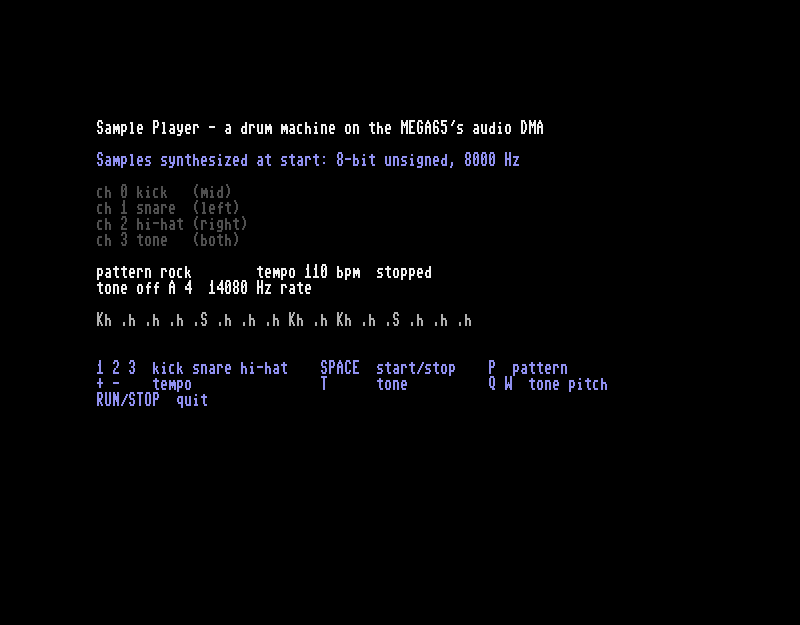

### keyboard_viewer

[Source](https://github.com/CTalkobt/M65Compiler/tree/main/examples/c/keyboard_viewer) —
The MEGA65 keyboard drawn with conio; every frame each key of the 8x8
matrix is read with `key_pressed()` (several at once, SHIFT and CTRL too)
and a held key shows reversed in yellow. Below, conio's `kbhit()` and the
characters `getch()` returns, with their PETSCII codes. It is the
interactive test of `kbhit`/`getch` (headless xemu can't press keys): run it
in a windowed xemu or on a MEGA65. RUN/STOP quits.

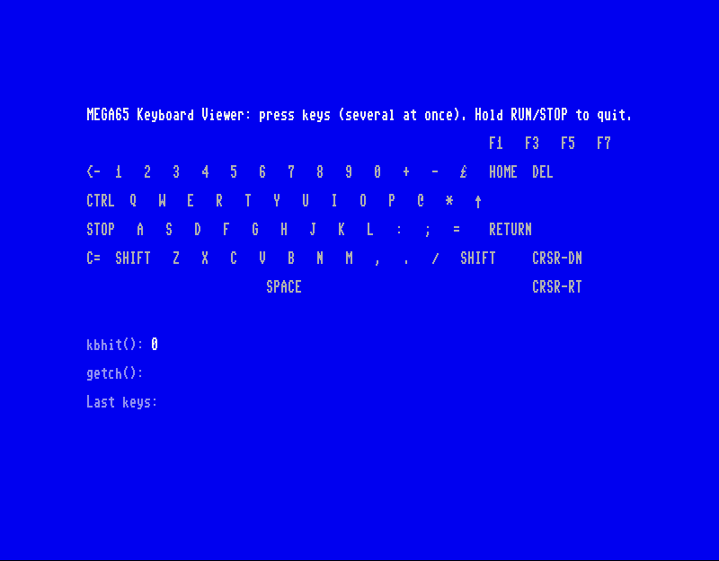

### rogue

[Source](https://github.com/CTalkobt/M65Compiler/tree/main/examples/c/rogue) —
A mini rogue-like: each level is a new random dungeon (a 3x3 grid of rooms,
some only a corridor crossing, joined along a random spanning tree plus a
few extra corridors), rooms light up when entered and what you have seen
stays on the map. Monsters (rats to dragons, by depth) wake when they see
you and chase you; walk into one to fight. Potions heal, weapons and armour
improve attack and defence, experience raises your level; the amulet waits
on depth 8. Monsters and items are structs with single inheritance
(`struct Monster : Thing`) and a method. Cursor keys or h/j/k/l and y/u/b/n
move, `>` goes down. `make check` tests levels from fixed seeds
(everything reachable, nothing overlapping), scripted moves, a fight and a
3000-step random walk.

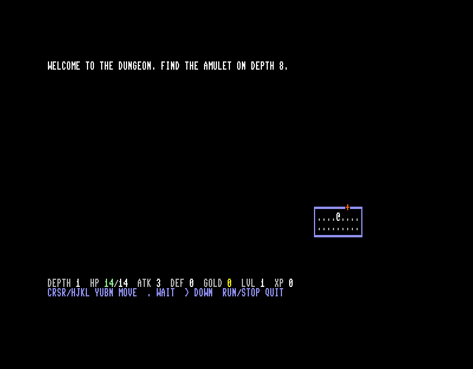

### hanger

[Source](https://github.com/CTalkobt/M65Compiler/tree/main/examples/c/hanger) —
Hangman with a different victim each level: a human, a cat, a duck, a
giraffe, an elephant and an octopus (6 to 9 wrong letters allowed). Each
wrong letter adds a part, and a hanged animal's eyes are crossed out. One
player guesses the computer's words (3 lives; solve a word to move on to the
next animal) or two players type secret words for each other. The words are
the 500 most common English words of 3 or more letters (`words.txt`, from the
wordfreq ranking; `make_words.py`), sorted by the misses of a player who
guesses letters in order of English frequency and cut into six tiers, one per
level. The pictures are drawn with PIL shapes in `gen_gfx.py` and cut into
8x8 character cells (in 80 columns a pixel is half as wide as it is tall, so
the shapes are drawn in square units and squeezed). Each level's glyphs, up
to 182, are copied into a character set in bank 4 with `dma_copy_far` when it
starts. Each stage of the drawing is stored as the cells it changes. The
generated `gfx.h` and `words.h` are in the repository, so the example builds
without Python (`make gfx` remakes them). The screen is built in two buffers
and copied out by DMA each frame. The sounds (a letter right or wrong, a
word won or lost) are in `sounds.txt`, played by the library's tune player
(`<audio_tune.h>`; `tune45 convert` makes `sounds.c`, `make sounds` plays them
on the PC). Untried letters show in the alphabet and
tried ones become dots; the wrong letters are listed by the miss count, so
nothing depends on colour alone. Keys: 1 or 2 on the title, A-Z to guess,
RETURN to go on, RUN/STOP back to the title or quit. `make demo` builds a
version that plays by itself (`DEMO_LEVEL=n` starts at level n).

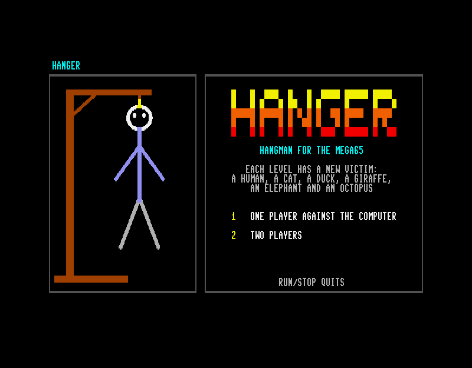

### fcm_graphics

[Source](https://github.com/CTalkobt/M65Compiler/tree/main/examples/c/fcm_graphics) —
The VIC-IV's full-colour characters: 64 bytes each, a byte a pixel, every
pixel a palette entry (`$00` the screen's background, `$FF` the character's
colour). `<conio.h>`'s full-colour mode (`fcm_enable`) uses them to give each
character its own background: the title's letters and the table of the 16
colours are drawn with `fcm_putch`, `fcm_cputs`, `fcm_cprintf` and
`fcm_fill_rect`, and conio makes the glyphs from the font. The plasma is 756
of the program's own characters (36x21 of them, 288x168 pixels: the screen's
left half), computed from a sine table
into bank 4 with `dma_copy_far` and placed with `fcm_putglyph`; each pixel is
one of 64 palette entries set to a colour wheel, as is the bar of 32
characters below it. It moves by palette cycling alone: each frame the 64
entries are rewritten one step further round and nothing on the screen
changes. Keys: SPACE pause, RUN/STOP quit. `make check` builds a test that
runs 100 frames, then reads cells back and reports on the screen.

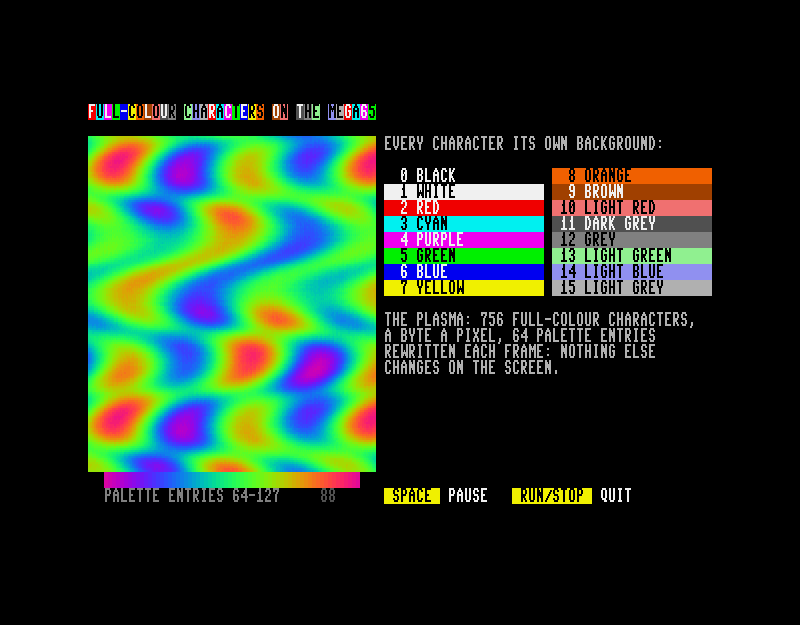

### glamlambs

[Source](https://github.com/CTalkobt/M65Compiler/tree/main/examples/c/glamlambs) —
Glam Lambs, a sheep makeover game. Catch an adult sheep in full fleece, carry
it to the salon and style it: wool dye, lipstick, eyelashes and a bow. Rams
seek out ewes, a lamb takes each trait from one of its parents, and the score
comes from the glam lambs born (more for later generations, double for the
season's trend) and the wool sold. Farmer Fergus comes out to shear full
fleeces, the made-up sheep first, which takes the makeup off. The screen is
80 x 25 multicolour characters (a multicolour pixel is square in 80 columns),
the glyphs (`gen_gfx.py`, from ASCII pictures; `gfx.h` is in the repository)
in a character set in bank 4, and the whole screen is built in two buffers
and copied out by DMA each frame. After a minute on the title page the
computer plays a season by itself.

The music is a nine-voice band on SIDs 2-4, written as tune45 text
(`music.txt`): in the field the farm band plays Old MacDonald, Baa, Baa,
Black Sheep and Mary Had a Little Lamb in turn, and the salon has a slow bump
and grind. The text was written from the game's own band, which built the
bass, chords and drums from one-bar patterns, and plays as it did, frame for
frame: the trombone's slides into a note are glides (`g4^3`), the kick drum's
fall is a fast glide down, and a tick is a frame, so the lead lets go a
frame before each note. As data the band is 4.4 KB, more than the game has
room for, so `tune45 convert --bin --load-at 0` writes it as `GLAMMUSIC`, which
the game loads from the disk into bank 5 at start (`cbm_setbnk`, `cbm_setnam`,
`cbm_setlfs`, `cbm_load` from `<cbm.h>`) and plays from there
(`tune_play_far`). Coming back from the salon, the farm songs carry on where
they were: the game keeps the tune's position (`tune_ticks` modulo the
`TUNE_FARM_TICKS` of a time through) and `tune_seek`s to it. The sound effects
(bleats, a birth's arpeggio, clicks) stay on SID 1 with `<audio_sid.h>`.
Without the music file the game plays silently. Keys: cursor keys / WASD or
a joystick to walk, SPACE / RETURN / fire to grab, style and let go, M music
on / off, RUN/STOP quit. `make` builds `glamlambs.d81` (the program and the
music), `make demo` a self-playing version, `make music` plays the band on
the PC.

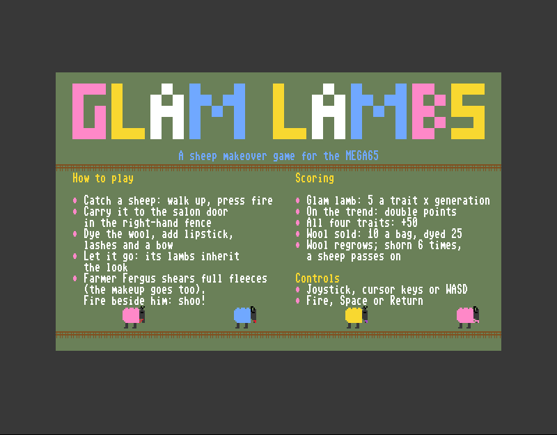

### tunes

[Source](https://github.com/CTalkobt/M65Compiler/tree/main/examples/c/tunes) —
The pfest game's music (its `music.txt`: 12 tunes on three voices, 2.6 KB)
played by the library's tune player, `<audio_tune.h>`. `tune45 convert`
turns the text into `music.c` and `music.h` as part of the build. The music
plays from a raster interrupt, as a game's would: `tune_update` runs in an
`__interrupt` handler once a frame (the player has no static allocation, so
ln45 allows it there), reached through a small stub at the KERNAL's `$0314`
vector that passes the other interrupts on. The main loop only draws: the
tunes, the one playing, and each voice's note (`tune_note`) as a bar. Keys:
CRSR or 1-9 a tune, SPACE stop/play, + - tempo, V vibrato, T G transpose, S
the game's "sick" music (faster, a wobble and a voice out of tune, made with
`tune_tempo`, `tune_vibrato` and `tune_detune`), RUN/STOP quit. `make play`
plays the music on the PC (`tune45 play`); `make check` builds a test that
plays from the interrupt for 150 frames and reports.

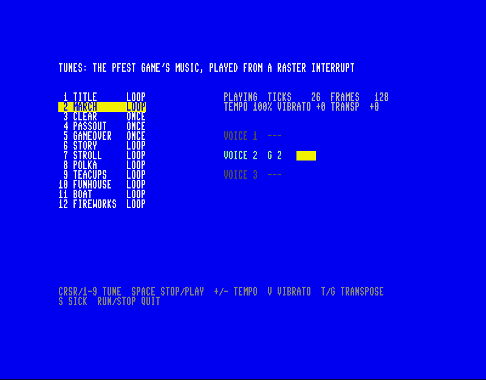

### forth

[Source](https://github.com/CTalkobt/M65Compiler/tree/main/examples/c/forth) —
A tiny Forth: a calculator you can program. Numbers go on a 16-bit stack,
words act on it (`2 3 + 4 * .` prints 20); `: sq dup * ;` defines a new word,
with `if`/`else`/`then`, `do`/`loop`/`i`, `begin`/`until`, variables and
constants; `*/`, `sqrt`, `hex`/`decimal`. A definition compiles to threaded
code that the inner interpreter runs with GCC's computed goto, one jump per
word (`goto *ops[code[ip++]]`); statement expressions, case ranges and a
nested function appear too. The picture shows the demo lines it runs at
start; type more at the keyboard, BYE or RUN/STOP returns to BASIC.

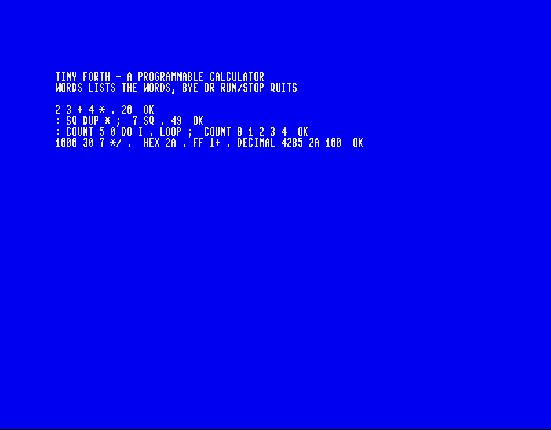

### far_scroller

[Source](https://github.com/CTalkobt/M65Compiler/tree/main/examples/c/far_scroller) —
A 400x25 landscape map allocated with `far_malloc` in bank 4, outside the
program's 64 KB, scrolled with one `dma_copy_far` per row each frame (the sky
at half speed: parallax); colours written straight into colour RAM at
`$FF80000` with `dma_fill_far`.

### text_scroller

[Source](https://github.com/CTalkobt/M65Compiler/tree/main/examples/c/text_scroller) —
A horizontal text scroller in C and assembly (arguments through shared
variables, so both calling conventions work), with a bouncing ball (hardware
sprite 0, VIC-IV 16-bit sprite pointers) that passes in front of and behind
the reverse-video message.

### game_of_life

[Source](https://github.com/CTalkobt/M65Compiler/tree/main/examples/c/game_of_life) —
Conway's Game of Life on the 80x25 text screen: 2D arrays, signed neighbour
offsets, direct screen RAM writes.

## Graphics and hardware registers

### palette_fade

[Source](https://github.com/CTalkobt/M65Compiler/tree/main/examples/c/palette_fade) —
C and assembly together: an assembly routine scales the VIC-IV palette's R/G/B
values by a fade level the C code steps up and down (shown mid-fade).

### vic4_colors

[Source](https://github.com/CTalkobt/M65Compiler/tree/main/examples/c/vic4_colors) —
A volatile struct overlaid on the border and background colour registers
(`$D020`/`$D021`), stepped through a few colours (shown part way), ending on
white with black text.

### bitfield_registers

[Source](https://github.com/CTalkobt/M65Compiler/tree/main/examples/c/bitfield_registers) —
VIC-III/VIC-IV control registers (`$D031`, `$D054`) as bitfield structs: reads
and changes single bits by name, enables sprites, writes characters with
VIC-III attributes.

### memset_screen

[Source](https://github.com/CTalkobt/M65Compiler/tree/main/examples/c/memset_screen) —
Fills screen RAM with each character code 0-255 in turn with `memset`.

## Programs that print

### hello_world

[Source](https://github.com/CTalkobt/M65Compiler/tree/main/examples/c/hello_world) —
The smallest program: `puts("hello world")`, built in one step with cc45.

### hello_linked

[Source](https://github.com/CTalkobt/M65Compiler/tree/main/examples/c/hello_linked) —
The same with separate compile and link steps (`cc45 -c`, `ln45`) and a few
library calls (`itoa`, `strlen`).

### multi_module

[Source](https://github.com/CTalkobt/M65Compiler/tree/main/examples/c/multi_module) —
A program in three C files with a shared header, compiled separately and
linked with ln45; prints the results of its vector functions and its own
checks.

### overlays

[Source](https://github.com/CTalkobt/M65Compiler/tree/main/examples/c/overlays) —
Code overlays: three tools (a prime sieve, the Towers of Hanoi, text
statistics), each a file with `#pragma cc45 overlay(name)`, share one
region of memory; ln45 writes their code to `OVLDEMO.OV1`, which the
program loads into bank 5 at start, and a call copies the overlay it
needs into the region by DMA. The text statistics call the prime sieve's
overlay and back; each section shows which overlay the region holds.
`make` also builds `ovldemo.d81` with both files (`make run`).

### mapped_overlays

[Source](https://github.com/CTalkobt/M65Compiler/tree/main/examples/c/mapped_overlays) —
Mapped code overlays (ln45 `--overlay-map`) checked at work. The 45GS02
runs only what it sees in its 64 KB, so far code means changing what it
sees. Here three overlays (`red`, `green`, `blue`) stay in bank 5, where
the program loaded `MAPDEMO.OV1`, and a call maps the window `$6000`–`$7FFF`
to the one it needs. Each overlay reports the window address of a byte of
its own code and the MAP registers at that moment. The program then checks,
from both sides (the CPU through MAP, and DMA directly), that:
1. MAP translates each overlay to its own place in bank 5;
2. the bytes there are the overlay's code;
3. a store through the window changes bank 5, and a change made in bank 5
   is seen through the window without a reload;
4. an overlay that calls another gets the window back.

It ends with `MAPPED OVERLAYS: 6/6 PROVEN`. Linked as copied overlays, only
2/6 pass, because the code would then run from one copy in bank 0. The
comments in `main.c` walk through the call path. `make` builds
`mapdemo.d81`.

### far_functions

[Source](https://github.com/CTalkobt/M65Compiler/tree/main/examples/c/far_functions) —
`__far` functions: their code is kept in bank 5 and mapped into the
window `$6000`–`$7FFF` when called, with no pragma and no linker option.
Three files mix resident and far code:
- far math functions (a sieve whose table stays resident, `fib`, `gcd`
  with a static far helper);
- far text functions that call the resident library (`isalpha`, `printf`);
- a far `checksum` in `main.c`, beside a resident function with the same
  code.

Each result shows the automatic overlay (`far1`) that ran it. `make`
builds `fardemo.d81`; the map file `fardemo.map` shows the overlays and the
stubs.

### unit_convert

[Source](https://github.com/CTalkobt/M65Compiler/tree/main/examples/c/unit_convert) —
Miles/kilometres conversion in 32-bit fixed point (`long`), with `sprintf` and
`sscanf`.

### ctype_demo

[Source](https://github.com/CTalkobt/M65Compiler/tree/main/examples/c/stdlib/ctype_h) —
`<ctype.h>` on PETSCII: classifies a few characters and converts their case.

## BASIC and C

### c_routines

[Source](https://github.com/CTalkobt/M65Compiler/tree/main/examples/basic/c_routines) —
A BASIC 65 program (basic45 source with labels) that calls C functions:
`basic45 --link routines.c menu.bas` compiles the C file with cc45 and links it
after the BASIC program. The picture shows its results and the prompt for the
next part.

## Library checks

These programs check standard library functions and return 0 (in A, and as
the exit status at `$FD/$FE`) when they all pass; they print nothing, so
their screen is BASIC's `READY.`.

| Program | Checks | Source |
|---------|--------|--------|
| test_atoi | `atoi` | [stdlib_h](https://github.com/CTalkobt/M65Compiler/blob/main/examples/c/stdlib/stdlib_h/test_atoi.c) |
| test_itoa | `itoa` | [stdlib_h](https://github.com/CTalkobt/M65Compiler/blob/main/examples/c/stdlib/stdlib_h/test_itoa.c) |
| test_memops | `memset`, `memcpy`, `memcmp` | [string_h](https://github.com/CTalkobt/M65Compiler/blob/main/examples/c/stdlib/string_h/test_memops.c) |
| test_strchr | `strchr`, `strrchr` | [string_h](https://github.com/CTalkobt/M65Compiler/blob/main/examples/c/stdlib/string_h/test_strchr.c) |
| test_strcmp | `strcmp` | [string_h](https://github.com/CTalkobt/M65Compiler/blob/main/examples/c/stdlib/string_h/test_strcmp.c) |
| test_strcpy | `strcpy` | [string_h](https://github.com/CTalkobt/M65Compiler/blob/main/examples/c/stdlib/string_h/test_strcpy.c) |
| test_strlen | `strlen` | [string_h](https://github.com/CTalkobt/M65Compiler/blob/main/examples/c/stdlib/string_h/test_strlen.c) |

`math_h` (`gcd`/`lcm`, `min`/`max`) is built and run by its own Makefile, not
by `make -C examples`.

## Assembly

[`examples/asm/zpcall_prototype.s45`](https://github.com/CTalkobt/M65Compiler/blob/main/examples/asm/zpcall_prototype.s45)
is a stand-alone assembly prototype of the ZP parameter-block calling
convention from early in the project (parameters at `$03`-`$12`; cc45's
convention now uses `$10`-`$2F`, see
[calling conventions](../architecture/calling-conventions.md)): nested calls,
a 32-bit result in A/X/Y/Z, an ltoa-style conversion.
