# Examples

The programs in [`examples/`](https://github.com/CTalkobt/M65Compiler/tree/main/examples),
each with what it shows and its screen 2.5 seconds after it starts (xemu-xmega65,
real speed). Build them all with `make -C examples` (or `make` in one example's
directory; most have `make run` to start xemu). The pictures are made by
[`examples/capture_screens.py`](https://github.com/CTalkobt/M65Compiler/blob/main/examples/capture_screens.py)
(run from the project root after building the examples).

The MEGA65's own boot screen and `READY.` prompt show in the pictures of the
programs that print text and return to BASIC.

## Games and demos

### invaders

[Source](https://github.com/CTalkobt/M65Compiler/tree/main/examples/c/invaders) —
A Space Invaders game. The game objects are structs with single inheritance
and virtual `update()`/`draw()`, positions an operator-overloaded `Vec2`. The
character set is copied to bank 4 with `dma_copy_far` and redefined (aliens,
shields); the cannon and UFO are 16-colour VIC-IV sprites; SID sound effects
and the marching beat. An attract mode plays by itself (shown); FIRE or SPACE
starts a game, Z/X, `,`/`.`, the cursor keys or a joystick move, RUN/STOP quits.

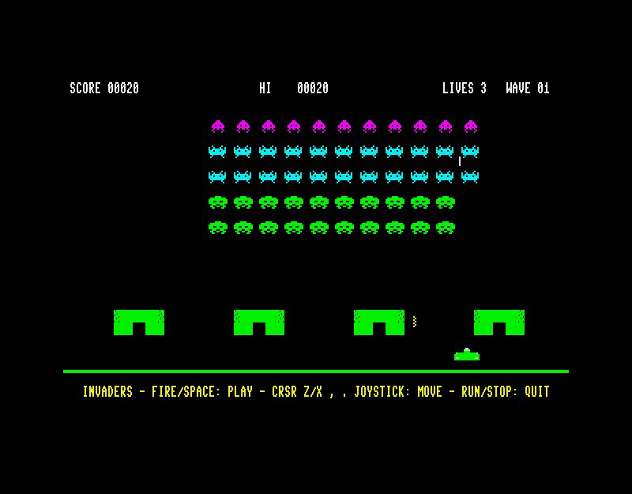

### mandelbrot

[Source](https://github.com/CTalkobt/M65Compiler/tree/main/examples/c/mandelbrot) —
A Mandelbrot set viewer: the VIC-IV's full-colour character mode as a
320x192 bitmap (a byte per pixel in bank 4), the iteration in 45GS02
assembly (the 32-bit Q register and the hardware multiplier, 4.28 fixed
point), progressive rendering with border checks (the picture is still
filling in at 2.5 seconds), palette cycling. Cursor keys or a joystick move,
Z/X zoom, `?` shows the keys.

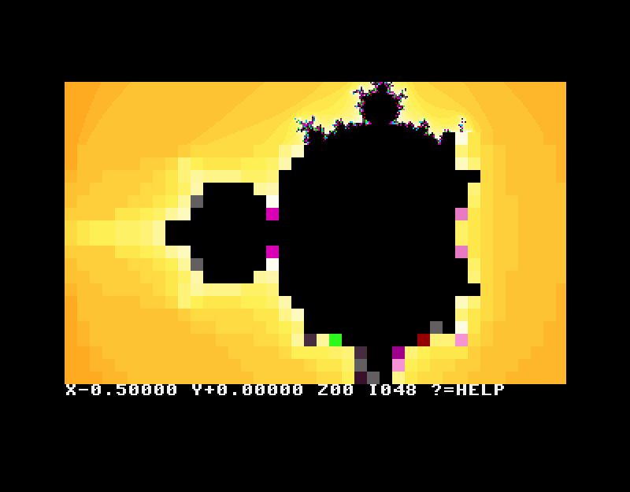

### musicgen

[Source](https://github.com/CTalkobt/M65Compiler/tree/main/examples/c/musicgen) —
A random music generator in seven styles (pop, rock, blues, jazz,
classical, ambient, chiptune): Markov chord tables with fixed cadences, AABA
or 12-bar blues form, melodies built from a motif with chord tones on the
strong beats, voice-led chords, walking/boogie/Alberti bass and drums with
swing, played by 14 SID instruments on four SIDs. Keys 1-7 choose the style,
`+`/`-` the tempo, N a new song. `make check` composes songs of every style
and checks them against the chords and scales.

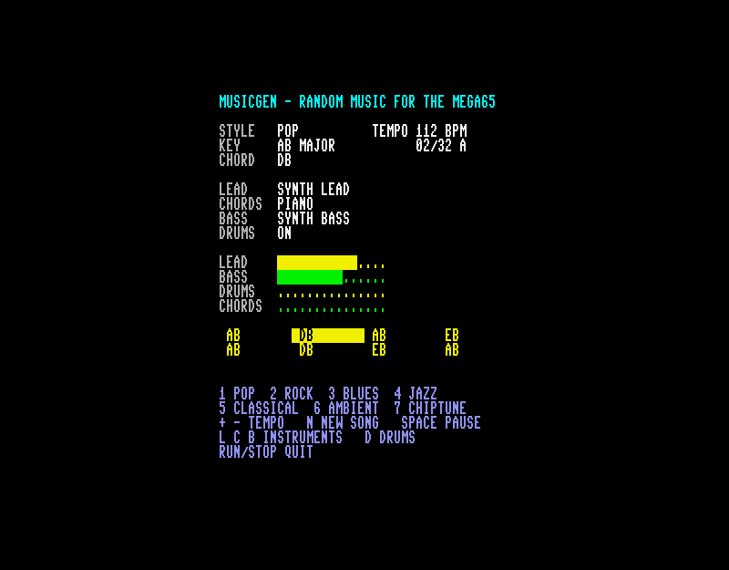

### far_scroller

[Source](https://github.com/CTalkobt/M65Compiler/tree/main/examples/c/far_scroller) —
A 400x25 landscape map allocated with `far_malloc` in bank 4, outside the
program's 64 KB, scrolled with one `dma_copy_far` per row each frame (the sky
at half speed: parallax); colours written straight into colour RAM at
`$FF80000` with `dma_fill_far`.

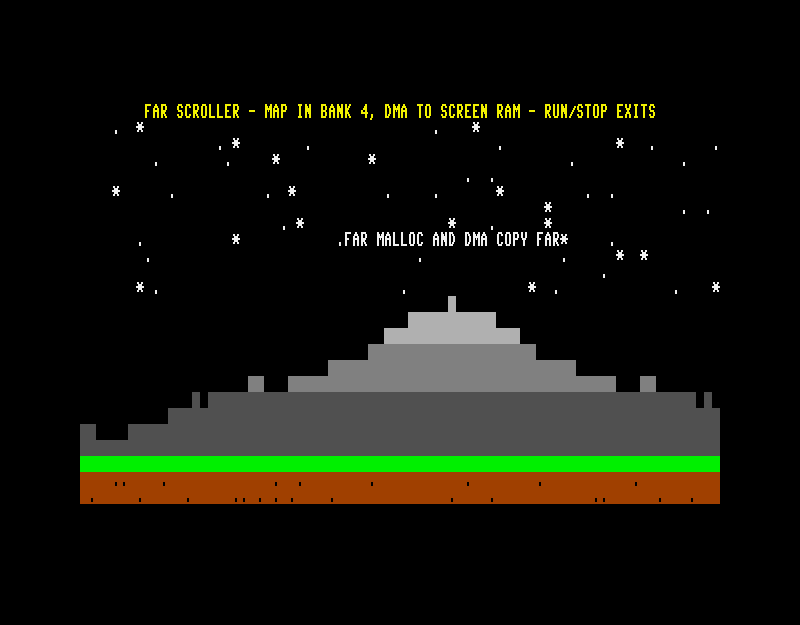

### text_scroller

[Source](https://github.com/CTalkobt/M65Compiler/tree/main/examples/c/text_scroller) —
A horizontal text scroller in C and assembly (arguments through shared
variables, so both calling conventions work), with a bouncing ball (hardware
sprite 0, VIC-IV 16-bit sprite pointers) that passes in front of and behind
the reverse-video message.

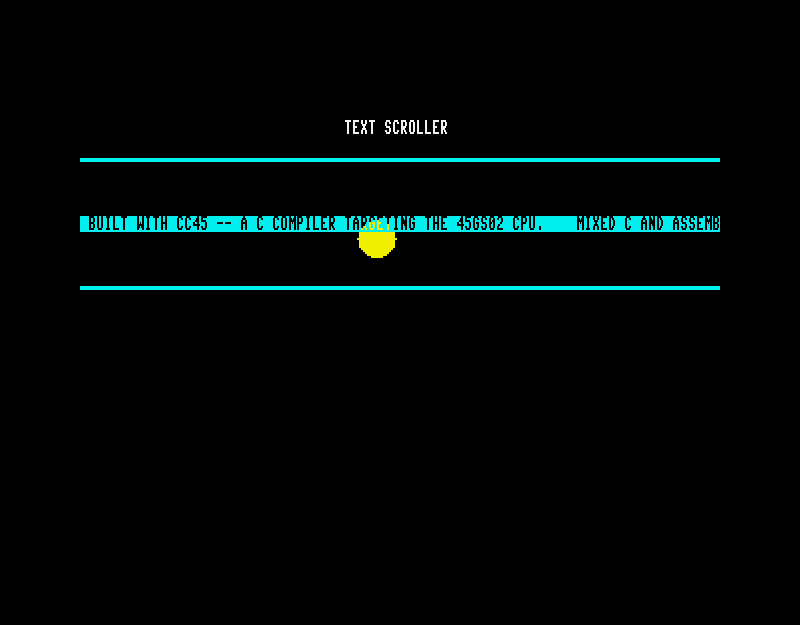

### game_of_life

[Source](https://github.com/CTalkobt/M65Compiler/tree/main/examples/c/game_of_life) —
Conway's Game of Life on the 80x25 text screen: 2D arrays, signed neighbour
offsets, direct screen RAM writes.

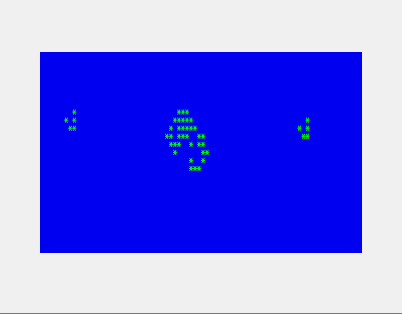

## Graphics and hardware registers

### palette_fade

[Source](https://github.com/CTalkobt/M65Compiler/tree/main/examples/c/palette_fade) —
C and assembly together: an assembly routine scales the VIC-IV palette's R/G/B
values by a fade level the C code steps up and down (shown mid-fade).

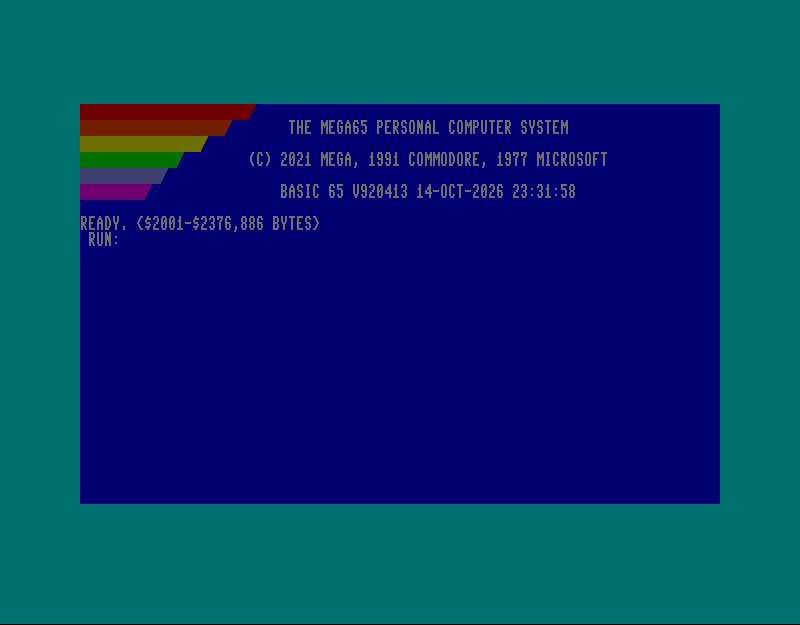

### vic4_colors

[Source](https://github.com/CTalkobt/M65Compiler/tree/main/examples/c/vic4_colors) —
A volatile struct overlaid on the border and background colour registers
(`$D020`/`$D021`), stepped through a few colours (shown part way), ending on
white with black text.

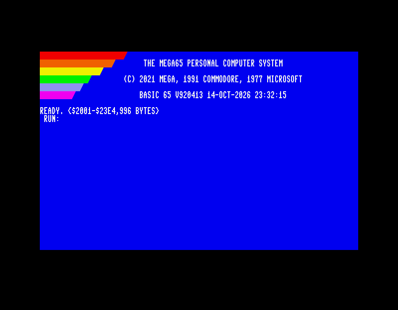

### bitfield_registers

[Source](https://github.com/CTalkobt/M65Compiler/tree/main/examples/c/bitfield_registers) —
VIC-III/VIC-IV control registers (`$D031`, `$D054`) as bitfield structs: reads
and changes single bits by name, enables sprites, writes characters with
VIC-III attributes.

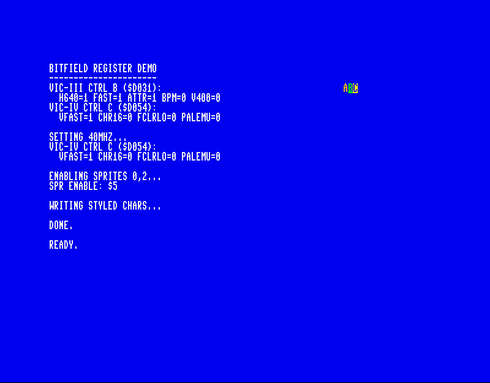

### memset_screen

[Source](https://github.com/CTalkobt/M65Compiler/tree/main/examples/c/memset_screen) —
Fills screen RAM with each character code 0-255 in turn with `memset`.

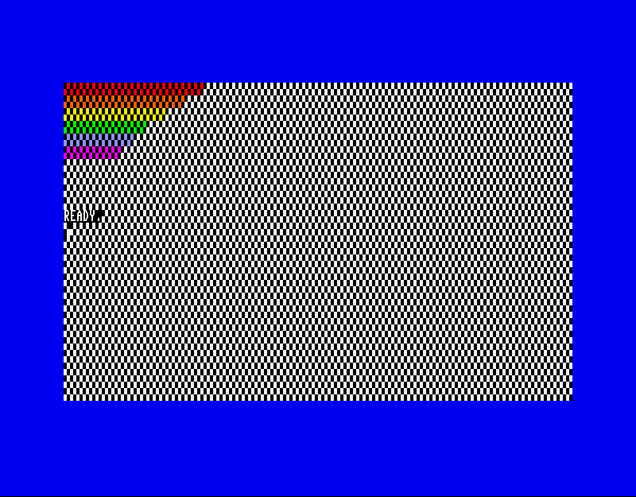

## Programs that print

### hello_world

[Source](https://github.com/CTalkobt/M65Compiler/tree/main/examples/c/hello_world) —
The smallest program: `puts("hello world")`, built in one step with cc45.

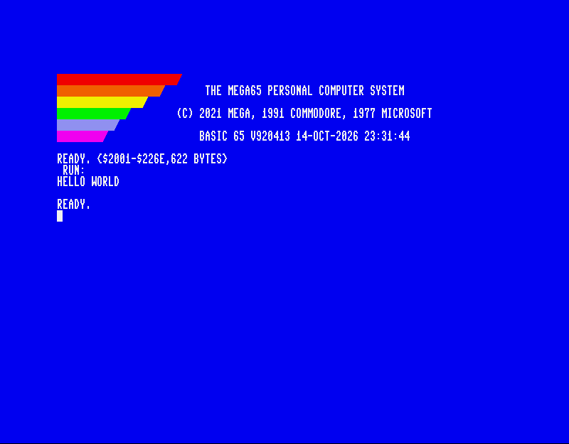

### hello_linked

[Source](https://github.com/CTalkobt/M65Compiler/tree/main/examples/c/hello_linked) —
The same with separate compile and link steps (`cc45 -c`, `ln45`) and a few
library calls (`itoa`, `strlen`).

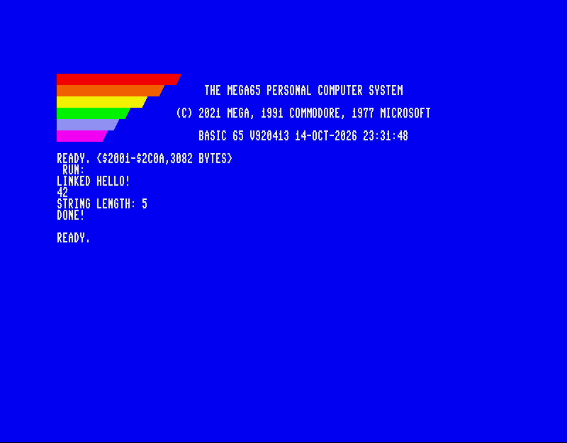

### multi_module

[Source](https://github.com/CTalkobt/M65Compiler/tree/main/examples/c/multi_module) —
A program in three C files with a shared header, compiled separately and
linked with ln45; prints the results of its vector functions and its own
checks.

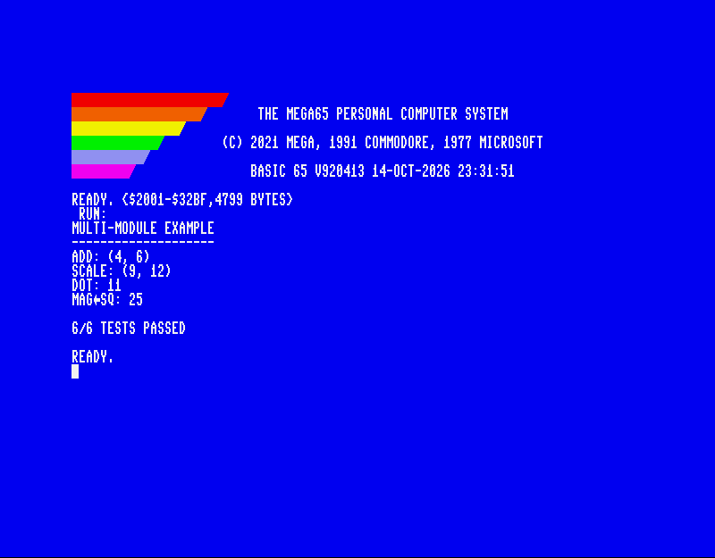

### unit_convert

[Source](https://github.com/CTalkobt/M65Compiler/tree/main/examples/c/unit_convert) —
Miles/kilometres conversion in 32-bit fixed point (`long`), with `sprintf` and
`sscanf`.

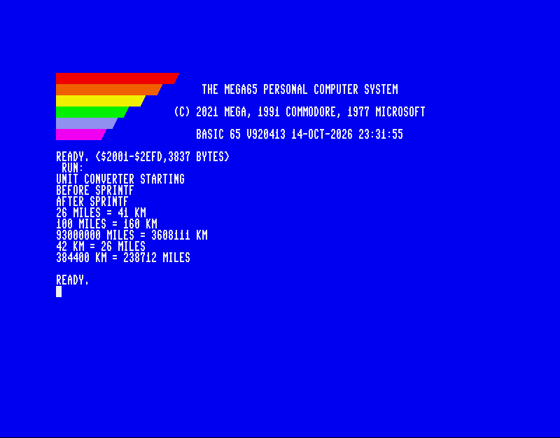

### ctype_demo

[Source](https://github.com/CTalkobt/M65Compiler/tree/main/examples/c/stdlib/ctype_h) —
`<ctype.h>` on PETSCII: classifies a few characters and converts their case.

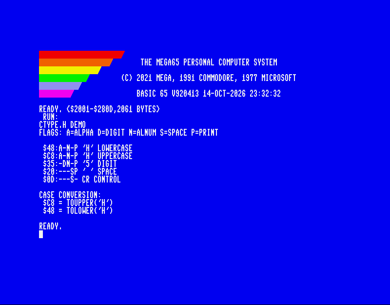

## BASIC and C

### c_routines

[Source](https://github.com/CTalkobt/M65Compiler/tree/main/examples/basic/c_routines) —
A BASIC 65 program (basic45 source with labels) that calls C functions:
`basic45 --link routines.c menu.bas` compiles the C file with cc45 and links it
after the BASIC program. The picture shows its results and the prompt for the
next part.

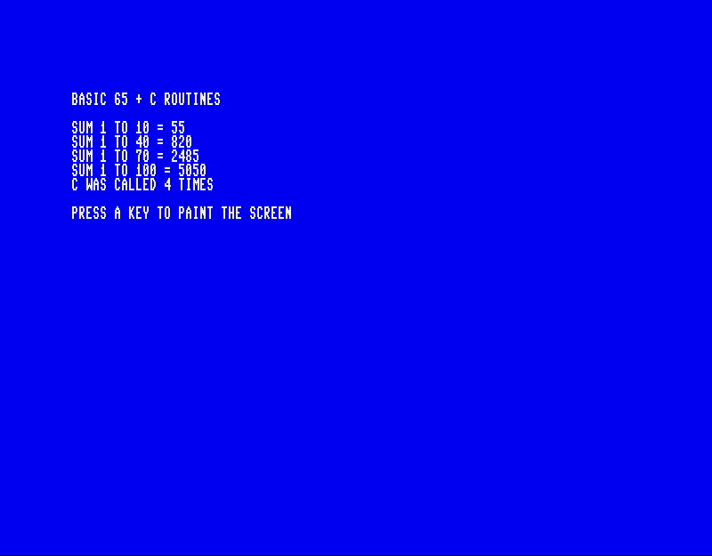

## Library checks

These programs check standard library functions and return 0 (in A, and as
the exit status at `$FD/$FE`) when they all pass; they print nothing, so
their screen is BASIC's `READY.`.

| Program | Checks | Source |
|---------|--------|--------|
| test_atoi | `atoi` | [stdlib_h](https://github.com/CTalkobt/M65Compiler/blob/main/examples/c/stdlib/stdlib_h/test_atoi.c) |
| test_itoa | `itoa` | [stdlib_h](https://github.com/CTalkobt/M65Compiler/blob/main/examples/c/stdlib/stdlib_h/test_itoa.c) |
| test_memops | `memset`, `memcpy`, `memcmp` | [string_h](https://github.com/CTalkobt/M65Compiler/blob/main/examples/c/stdlib/string_h/test_memops.c) |
| test_strchr | `strchr`, `strrchr` | [string_h](https://github.com/CTalkobt/M65Compiler/blob/main/examples/c/stdlib/string_h/test_strchr.c) |
| test_strcmp | `strcmp` | [string_h](https://github.com/CTalkobt/M65Compiler/blob/main/examples/c/stdlib/string_h/test_strcmp.c) |
| test_strcpy | `strcpy` | [string_h](https://github.com/CTalkobt/M65Compiler/blob/main/examples/c/stdlib/string_h/test_strcpy.c) |
| test_strlen | `strlen` | [string_h](https://github.com/CTalkobt/M65Compiler/blob/main/examples/c/stdlib/string_h/test_strlen.c) |

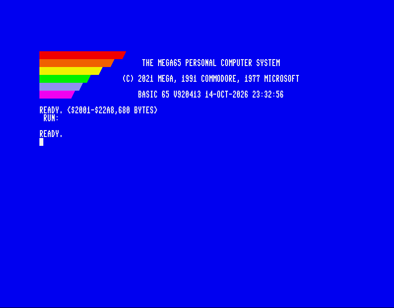

`math_h` (`gcd`/`lcm`, `min`/`max`) is built and run by its own Makefile, not
by `make -C examples`.

## Assembly

[`examples/asm/zpcall_prototype.s45`](https://github.com/CTalkobt/M65Compiler/blob/main/examples/asm/zpcall_prototype.s45)
is a stand-alone assembly prototype of the ZP parameter-block calling
convention from early in the project (parameters at `$03`-`$12`; cc45's
convention now uses `$10`-`$2F`, see
[calling conventions](../architecture/calling-conventions.md)): nested calls,
a 32-bit result in A/X/Y/Z, an ltoa-style conversion.
